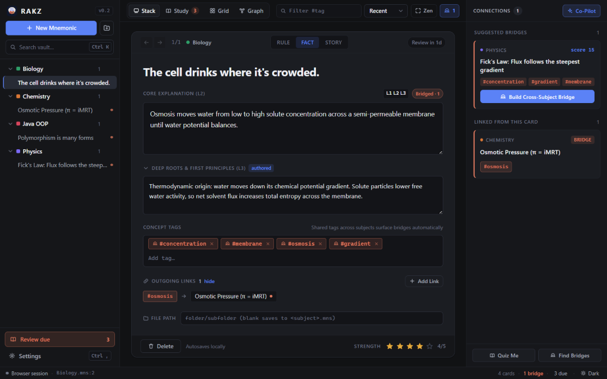
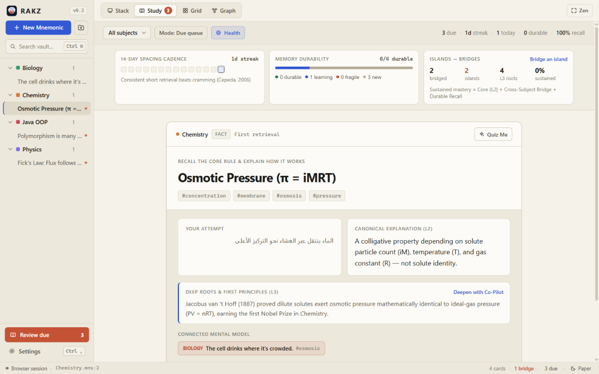

<div align="center">
  
  <h1>RAKZ</h1>
  <p><strong>Full mnemonic lifecycle management — local-first, offline-ready, and built for sustained learning.</strong></p>

  <p>
    <a href="https://github.com/ObiedaM/Rakz/actions/workflows/ci.yml">
      
    </a>
    <a href="https://github.com/ObiedaM/Rakz/actions/workflows/packages.yml">
      
    </a>
    <a href="https://github.com/ObiedaM/Rakz/actions/workflows/release.yml">
      
    </a>
    <a href="https://github.com/ObiedaM/Rakz/releases/latest">
      
    </a>
    <a href="LICENSE">
      
    </a>
  </p>

  <p>
    <a href="https://github.com/ObiedaM/Rakz/releases/latest"><strong>Download (Windows · macOS · Linux)</strong></a>
    &nbsp;·&nbsp;
    <a href="#why-rakz">Why RAKZ</a>
    &nbsp;·&nbsp;
    <a href="#packages">Packages</a>
    &nbsp;·&nbsp;
    <a href="#architecture">Architecture</a>
    &nbsp;·&nbsp;
    <a href="#security--privacy">Security</a>
  </p>
</div>

---

**RAKZ** turns isolated facts into a durable, user-owned knowledge graph stored as plain-text `.mns` files on your computer. Author layered mnemonics, bridge concepts across disciplines, train long-term memory with graduated active recall and spaced repetition, and optionally connect your own OpenRouter API key for a read-only Socratic co-pilot.

<p align="center">
  
</p>
<p align="center">
  <sub><strong>Card Studio (Precision Dark)</strong> — Three learning depth layers (L1 Hook, L2 Core, L3 Deep Roots) with live cross-subject bridge suggestions and bidirectional connections.</sub>
</p>

<br />

<p align="center">
  
</p>
<p align="center">
  <sub><strong>Sustained Study Mode (Warm Paper &amp; Ink Light)</strong> — 14-day spacing cadence, memory durability tiers, Islands → Bridges mastery diagnostics, and native bilingual Arabic (RTL) + English (LTR) active recall.</sub>
</p>

---

## Download (Windows 11 · macOS · Linux)

Prebuilt, checksum-verified installers for **Windows 11**, **macOS (Apple Silicon & Intel)**, and **Linux** are built automatically on GitHub Actions for every release:

| Platform | Package | Install / Run | Download |
| --- | --- | --- | --- |
| **Windows 11** *(x64)* | **NSIS Installer** *(recommended)* | Run `*-setup.exe` (per-user, no admin required, embeds WebView2) | [Latest Release](https://github.com/ObiedaM/Rakz/releases/latest) |
| **Windows 11** *(x64)* | **MSI Installer** / **Portable `.exe`** | Run `*.msi` or launch standalone `rakz.exe` directly | [Latest Release](https://github.com/ObiedaM/Rakz/releases/latest) |
| **macOS 11+** *(Universal)* | **Universal `.dmg`** *(M1–M4 + Intel)* | Open `.dmg` → drag `RAKZ.app` to Applications | [Latest Release](https://github.com/ObiedaM/Rakz/releases/latest) |
| **Linux** *(x86_64)* | **`.AppImage`** *(portable)* | `chmod +x RAKZ_*.AppImage && ./RAKZ_*.AppImage` | [Latest Release](https://github.com/ObiedaM/Rakz/releases/latest) |
| **Linux** *(Debian / Ubuntu)* | **`.deb`** | `sudo apt install ./RAKZ_*_amd64.deb` | [Latest Release](https://github.com/ObiedaM/Rakz/releases/latest) |
| **Linux** *(Fedora / RHEL / openSUSE)* | **`.rpm`** | `sudo dnf install ./RAKZ-*.x86_64.rpm` | [Latest Release](https://github.com/ObiedaM/Rakz/releases/latest) |
| **All Platforms** | **`SHA256SUMS.txt`** | Verify download integrity with SHA-256 | [Latest Release](https://github.com/ObiedaM/Rakz/releases/latest) |

> **macOS first-launch note:** Because RAKZ is a community open-source release without a paid Apple Developer notarization certificate, macOS Gatekeeper may warn on first open. Clear the quarantine flag once in Terminal after moving `RAKZ.app` to Applications:
> ```bash
> xattr -cr /Applications/RAKZ.app
> ```

---

## Why RAKZ

Most flashcard apps optimize for short-term cramming. RAKZ is built around peer-reviewed learning science and a **three-layer sustained learning loop**:

1. **Three Depth Layers (`L1 → L2 → L3`):**
   - **L1 — Condensed Hook:** A vivid anchor or rule for instant recall.
   - **L2 — Core Explanation:** Your own self-authored explanation of how the mechanism works.
   - **L3 — Deep Roots & First Principles:** Historical origins, derivations, and transfer notes stored locally in `.study/reviews.json` without cluttering your `.mns` cards.
2. **Islands → Bridges → Sustained Mastery:**
   - Isolated facts decay quickly. Shared `#concept` tags automatically surface **Cross-Subject Bridge** suggestions (e.g., Biology ↔ Chemistry ↔ Physics) alongside outgoing links and incoming backlinks.
   - Study Mode tracks **14-day spacing cadence**, **forgetting-curve durability** (`New`, `Learning`, `Fragile`, `Durable`), and **Isolated Islands** with 1-click actions to bridge islands or review decaying cards.
3. **Graduated Active Recall (Desirable Difficulties):**
   - **Cold Recall** hides `#tags` by default and pairs your scratchpad with selectable metacognitive prompts (*Mechanism*, *Ask Why*, *Transfer*).
   - **Optional Hint (`H`)** reveals `#tags` and bridged disciplines without spoiling the answer.
   - **Full Reveal (`Space`)** compares your attempt side-by-side against L2 + L3 and schedules your next check (`1 Again`, `2 Hard`, `3 Good`, `4 Easy`).
4. **Restrained Socratic Co-Pilot (Optional BYOK):**
   - Five read-only modes (*Quiz Me*, *Find Bridges*, *Critique Hook*, *Ask Why*, *Ask*) powered by your own OpenRouter key — scaffolds critical thinking without writing cards for you.
5. **Native Bilingual RTL & Dual Themes:**
   - Automatic `dir="auto"` alignment for seamless Arabic (RTL) and English (LTR) study notes, plus **Precision Dark** and **Warm Paper & Ink Light** themes synced to native window chrome.

---

## Packages

The pure TypeScript mnemonic domain engine is published to **GitHub Packages** as `@obiedam/rakz-engine` (zero DOM, Vue, or Tauri dependencies):

```bash
# Point @obiedam scope to GitHub Packages in your .npmrc
echo "@obiedam:registry=https://npm.pkg.github.com" >> .npmrc

# Install the engine package
npm install @obiedam/rakz-engine
```

Browse published versions under [GitHub Packages](https://github.com/ObiedaM/Rakz/packages).

---

## Architecture

RAKZ enforces a strict three-layer separation:

```text
app_folder/    (Vue 3 + TypeScript + Tauri 2 shell)
   └── composables/library/*   ← ONLY data-layer boundary
         ├── engine_folder/    (@rakz/engine — pure TS domain store, link scoring, bridge)
         └── io_folder/        (rakz-io — sandboxed async Rust IO + OS keyring)
```

| Folder | Role | Guardrails |
| --- | --- | --- |
| `engine_folder/` | Pure TypeScript domain store, actions, link scoring, and `.mns` bridge | Zero DOM, Vue, or Tauri imports; untouched by UI shell |
| `io_folder/` | `rakz-io` Rust crate — 9 async Tauri commands (`safe_join`, atomic writes, OS keyring) | No parsing, no business logic, no network |
| `app_folder/` | Vite + Vue 3 + TypeScript frontend + thin Tauri 2 desktop shell | UI components import only `@/composables/library` |

### Non-Negotiable Invariants

1. Only `app_folder/src/composables/library/*` imports `@engine/*` and `@tauri-apps/*` (exception: `agent/keychain.ts`, secrets only — enforced by automated tests).
2. Every engine mutation is followed by `refresh()` returning deep snapshots (never shared mutable references).
3. Zero native `confirm()` / `alert()` / `prompt()` — destructive actions use accessible two-step arm → confirm controls with timeout reset and `Esc` cancel.
4. Saves and `locateCard` share a single canonical serializer and NTFS case-safe file grouping path (`persistence.ts`).
5. Boot guards remain intact: HMR skip-reimport, single-instance plugin registered first, `dedupeExactClones()` healer, and ready-gated saves.
6. Dot-directories (`.exports/`, `.study/`) and `settings.json` remain invisible to the vault scanner.

---

## Security & Privacy

See [SECURITY.md](SECURITY.md) for the full threat model and vulnerability disclosure policy.

- **100% Local-First:** Plain-text `.mns` vault files live on your disk — zero accounts, zero analytics, zero telemetry.
- **Strict Content Security Policy:** Desktop builds restrict scripts to `'self'`, disallow plugins/frames, and limit outbound connections strictly to local IPC and `https://openrouter.ai`.
- **Sandboxed File IO:** Rust `safe_join` blocks path traversal, backslashes, NUL bytes, and Windows Alternate Data Streams (`:`), verifies canonical containment, and limits `open_mns_file` to `.mns`, `.rkz`, `.txt`, and `.json`.
- **OS Keychain Secret Isolation:** Optional OpenRouter API keys live solely in Windows Credential Manager, macOS Keychain, or Linux Secret Service — never in `settings.json`, vault files, or `localStorage`, sent only over HTTPS, and redacted from error messages.

---

## Keyboard Shortcuts

*(Use `⌘` instead of `Ctrl` on macOS)*

| Shortcut | Action |
| --- | --- |
| `Ctrl+N` | Create new mnemonic card |
| `Ctrl+K` | Focus vault search |
| `Ctrl+1 / 2 / 3 / 4` | Switch Stack / Study / Grid / Graph |
| `Ctrl+J` | Open Study Co-Pilot |
| `Ctrl+.` | Toggle Zen focus mode |
| `Ctrl+S` | Flush vault to disk immediately |
| `Ctrl+,` | Open Settings |
| `Alt+← / →` | Previous / next card in subject |
| `H` · `Space` · `1–4` | Hint, reveal, and grade in Study Mode |
| `Esc` | Cancel armed delete, close modal, or exit Zen |

---

## Local Development

**Prerequisites:** Node.js 22+, Rust stable toolchain (+ MSVC Build Tools on Windows, Xcode CLI tools on macOS, or WebKitGTK 4.1 dev libraries on Linux).

```bash
# Run inside app_folder/
cd app_folder
npm install          # uses .npmrc install-links=true (no Windows Developer Mode needed)
npm run dev          # Vite browser preview
npm run tauri dev    # Desktop app (Tauri 2)
npm run build        # vue-tsc strict typecheck + production bundle
npm run lint         # ESLint flat config
npm test             # Vitest unit & invariant suite
npm run tauri build  # Build native desktop binary & installers
```

Run Rust IO sandbox unit tests (cross-platform Windows, macOS & Linux):

```bash
cargo test --manifest-path io_folder/Cargo.toml
```

---

## License

Licensed under the [GNU General Public License v3.0](LICENSE).
